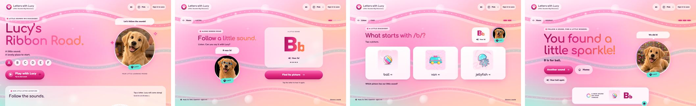
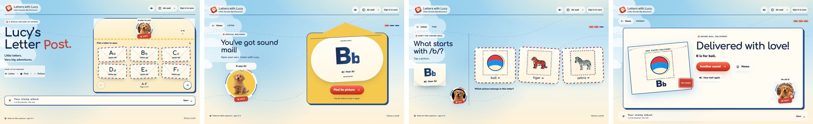
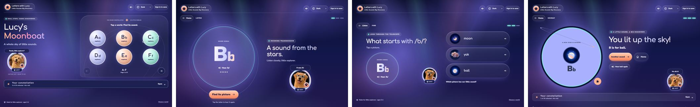
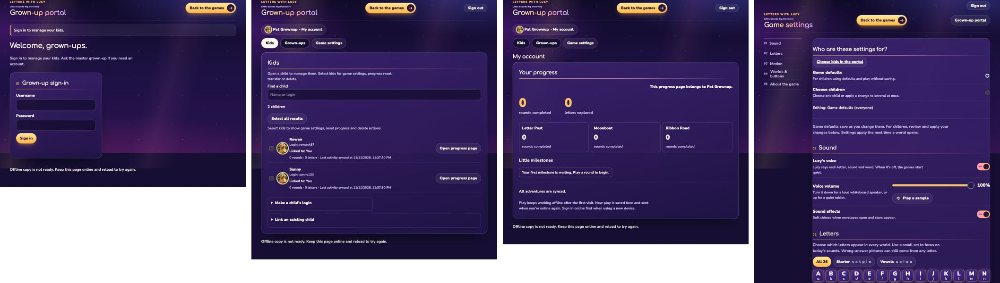

# Full-site redesign: every world and the grown-up area

Branch `claude/fullsite-redesign`, built on `claude/landing-redesign`. It carries the landing's look across the whole site: the three worlds and all their screens (home, listen, find, wrong answer, celebration, collections and themes), plus the grown-up portal, progress, account management and game settings.

## What changed

### The worlds

Each world now has its own living sky, its own materials and its own light, and each one matches the card that teases it on the picker. The skin is `v1-letter-post/worlds.css`, with scenery and pointer effects in `v1-letter-post/worlds.js`. All three worlds load both files last.

| World | New identity |
|---|---|
| **Ribbon Road** | A golden-hour sky with three satin ribbons swaying across it and floating bokeh. The letter beads look like glossy pearls, the picture cards are white satin, and the headlines run in a berry-to-peach gradient. Its three themes are pink, lilac and sunny yellow. |
| **Letter Post** | An airmail sky with drifting clouds, dotted flight routes and envelopes flying across. Picture cards and letter envelopes get red-and-blue airmail borders on cream paper, the buttons are stamp red, and the headline reads like a poster. Its themes are morning blue, candy pink and night mail, which has stars. |
| **Moonboat** | A night voyage with two twinkling star layers, swaying aurora curtains, drifting planets and shooting stars. The letter worlds look like glowing pearl planets, answers sit in glass portholes, and the sound badge glows. Its themes are deep night, cloud day and plum dusk. |

These touches are shared across all three worlds:
- Glass header pill with a gradient-ring logo.
- Glass tool buttons and pill controls.
- Headings set in Comfortaa (a rounded, friendly typeface).
- A pulsing dot on each eyebrow label.
- Gradient buttons with a light sweep.
- A spinning rainbow ring around Lucy.
- Picture cards that lift and tilt toward the mouse, with a glare that follows it.
- A spinning ring and glow behind the celebration.
- Staggered answer cards.
- Pointer parallax and a soft spotlight that follows the mouse across the sky.

### The grown-up area

`grown-ups/dusk.css` is loaded last by both grown-up pages, so they keep matching each other. It brings the sign-in page's dusk sky to the grown-ups:
- glass panels with a lit gold-to-teal edge
- gold primary buttons
- glowing gradient headings
- dark glass fields with a teal focus glow
- pink-to-gold switches
- a gold-rimmed letter grid
- world swatches that match each world's new colours

The grown-up pages stay calmer than the worlds: one slow beam of light and no pointer effects.

### Renames

The world names now match the picker everywhere. The internal IDs (`post`, `space`, `silk`) and the stored values are unchanged, so saved settings and progress keep working.

| Was | Now | Where |
|---|---|---|
| Lucy's Letter Post | **Letter Post** | browser tab title, portal progress cards, game settings toggle, `config.js` |
| Lucy's Moonboat | **Moonboat** | browser tab title, portal progress cards, game settings toggle, `config.js` |
| Choose a layout (in-game footer link) | **Choose a world** | all three worlds |

Each world's playful home headline ("Lucy's Letter Post.", "Lucy's Moonboat", "Lucy's Ribbon Road.") is kept.

### Kept exactly

- **Sounds:** every clip, `audio-map.js` and `voice-manifest.json`. The approved-audio check still passes with exact hashes.
- **Pictures and Lucy:** every picture card and Lucy image file is unchanged. Lucy now gets new framing (rings, halos and glows), but her photos are the same files.
- **Layout and sizes:** the engine, every ID and data attribute, the touch-target sizes and the whiteboard sizes the layout tests measure.
- **Gameplay:** unchanged. No game rules, words or flows changed, so no new audio is needed.

## Game changes and new cards

None in this pass. See questions 1 and 2 below.

## AUDIO NEEDED

None. No new words, cards or voice lines were added.

## Motion and calm

- **What animates:** only transform and opacity, which keeps it smooth on modest hardware. `motion_smoke` enforces this, and it passes.
- **What stands still:** the dashed routes and ribbons don't animate, because the motion test forbids that kind of line animation in the worlds.
- **Hover lifts:** they use the separate translate and scale properties, so under reduced motion or the calm setting hovering moves nothing.
- **Calm mode:** reduced motion and the grown-ups' calm setting stop all scenery and transitions. The same scene shows standing still.

## Screenshots

Each image shows home, listen, find and celebration from left to right (grown-ups: sign-in, kids, my account, settings). "Before" is `codex/home-flow-ribbon`. Both sets were taken with reduced motion so every element shows.

| | Desktop 1440×900 | Tablet 768×1024 | Phone 390×844 |
|---|---|---|---|
| Ribbon Road | [before](fullsite-redesign/ribbon-road-desktop-before.jpg) · [after](fullsite-redesign/ribbon-road-desktop-after.jpg) | [before](fullsite-redesign/ribbon-road-tablet-before.jpg) · [after](fullsite-redesign/ribbon-road-tablet-after.jpg) | [before](fullsite-redesign/ribbon-road-phone-before.jpg) · [after](fullsite-redesign/ribbon-road-phone-after.jpg) |
| Letter Post | [before](fullsite-redesign/letter-post-desktop-before.jpg) · [after](fullsite-redesign/letter-post-desktop-after.jpg) | [before](fullsite-redesign/letter-post-tablet-before.jpg) · [after](fullsite-redesign/letter-post-tablet-after.jpg) | [before](fullsite-redesign/letter-post-phone-before.jpg) · [after](fullsite-redesign/letter-post-phone-after.jpg) |
| Moonboat | [before](fullsite-redesign/moonboat-desktop-before.jpg) · [after](fullsite-redesign/moonboat-desktop-after.jpg) | [before](fullsite-redesign/moonboat-tablet-before.jpg) · [after](fullsite-redesign/moonboat-tablet-after.jpg) | [before](fullsite-redesign/moonboat-phone-before.jpg) · [after](fullsite-redesign/moonboat-phone-after.jpg) |
| Grown-ups | [before](fullsite-redesign/grownups-desktop-before.jpg) · [after](fullsite-redesign/grownups-desktop-after.jpg) | [before](fullsite-redesign/grownups-tablet-before.jpg) · [after](fullsite-redesign/grownups-tablet-after.jpg) | [before](fullsite-redesign/grownups-phone-before.jpg) · [after](fullsite-redesign/grownups-phone-after.jpg) |






## Preview locally

```sh
git checkout claude/fullsite-redesign
python3 -m http.server 8000
```

Open http://localhost:8000/, choose **Play without saving**, then pick a world. Try the theme menu in each world, and move the mouse over the sky and the picture cards. The grown-up area is at http://localhost:8000/accounts/. Signing in there needs a real account, so on a local preview it shows the sign-in page.

## Tests

All tests ran on macOS Chrome with the local mock backend. Browser DNS for `*.supabase.co` was blocked as a safety net. No live accounts or data were touched.

- `python3 tests/run_tests.py` passed **6/6** strict checks (approved audio hashes, trim metadata, wiring, voice inventory, A–Z coverage, themes).
- **44 browser and runtime suites pass:**
  - World screens and layout: `browser_smoke` (every world, theme and size), `motion_smoke`, `confetti_smoke`, `fix24_layout`, `layout_build`, `runtime_smoke` (234 rounds), `grown_ups_smoke`, `grown_ups_runtime`, `moonboat_theme_color`
  - Home, sign-in and accounts: `home_flow`, `portal_flow`, `accounts_sync`, `kid_signout`, `guest_link_flag`, `fixlist`
  - Offline: `offline_readiness`, `layout_offline`, `lucy_letters_offline`, `call_list_offline`, `failed_precache_cache`, `first_takeover_reload`
  - Rounds, progress and portal: `update_round_guard`, `takeover_round_race`, `progress`, `progress_sync`, `profile_picture_dirty`, `profile_rename_race`, `risky_actions_browser`, `portal_review_browser`, `kid_picture_browser`, `name_only_picture_refresh`, `picture_swap`, `tidy_1`, `tidy_1b`
  - Sound and celebration: `cancelled_press`, `celebrate_audio_rules`, `celebrate_delay`, `correct_word`, `fade_swap`, `call_list_sounds`

  `celebrate_delay` checks timing to within 300 ms. It failed once while three other test runs were competing for CPU, then passed when run alone.
- **Already failing on the untouched `codex/home-flow-ribbon` on this Mac, with the same messages:** `silk_smoke` (Ribbon Road's 56px theme menu), `lucy_letters`, `call_list_browser` and `tidy_1_update`. They look specific to macOS, since the suite targets Linux Chrome.
- **`layout_ribbon_unchanged`** asserts that Ribbon Road's markup and pixels never change. It already failed on this Mac at the pixel step. It now fails at its first step because Ribbon Road was redesigned, so by design it can't pass after this job. See question 4.
- **Not run:** the suites that use real accounts (`*_live`, `*_hosted`, `portal_master*`, `portal_round2`, `child_settings_browser`, `accounts_selection`, `master_login`), and the `*_database` and `*_edge` suites, which need `.job/db-tools`. None of them cover how pages look.

**Test edits, each because this redesign intentionally lifts an old lock or fixes a race:**
- `tests/moonboat_theme_color.cjs` now expects Moonboat's new theme backgrounds (`#0e1238`, `#e3e9ff`, `#2a1638`). The check that the browser theme colour follows the active theme is unchanged.
- `tests/grown_ups_smoke.cjs` now expects the grown-up page's new background in dark mode, `rgb(22, 15, 51)` instead of cream.
- `tests/home_flow.cjs` and `tests/guest_link_flag.cjs` use the new link name, "Choose a world".
- The shared `settle()` helper in `tests/accounts_sync.cjs` now also waits for the page's own scripts. Before this, a click that opened a new page could be read before that page loaded. The two extra files per world made that race show up about 1 run in 6; with the fix, 6 of 6 runs pass.
- `tests/verify-game/features/home.md` wording now says "Choose a world".

## Questions for Bradley

1. **New art.** You allowed new Lucy poses and regenerated picture cards, but this environment has no image generator, so I kept every existing image and gave Lucy new framing instead. Do you want new art? If so, the simplest route is to generate it in your usual tool and drop it in. I can wire it up and keep the old files in place.
2. **Gameplay improvements.** I left gameplay unchanged so the phonics flow and the tests stay intact. These are ideas I'd consider next, each needing your OK:
   - a short "Lucy points" hint animation after two misses
   - a calmer celebration choice for the whiteboard
   - letting kids replay a collected letter straight from the collection

   Want any of them?
3. **World names.** I kept Ribbon Road, Letter Post and Moonboat, because you already approved them on the picker, and only dropped "Lucy's" from the grown-up labels and tab titles. Would you like new names?
4. **The "Ribbon Road unchanged" test.** `tests/layout_ribbon_unchanged.cjs` was written to stop anyone changing Ribbon Road, and this job redesigns Ribbon Road by your request. Should I retire it, or rewrite it to protect the new look instead? I left it untouched until you decide.
