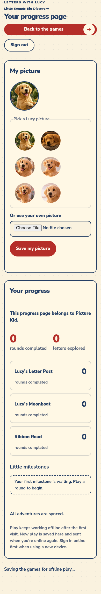
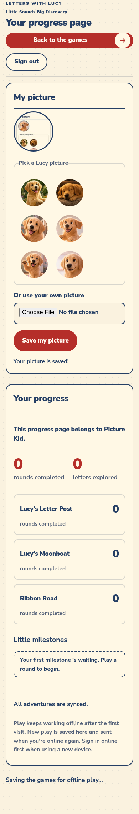

# KID-FIXES: Fix 2, kid picture picker (Claude)

Preview: https://raw.githack.com/TeslaWarpDrive/childrens-learning-game/test/kid-fixes-claude/index.html

**Status: built, but kids cannot save a picture until the migration is applied.** Until then the card shows "Your picture did not save. Please try again." and nothing changes.

Migration (NOT applied): `supabase/migrations/20261102120000_set_own_avatar.sql`

## What changed
- `supabase/migrations/20261102120000_set_own_avatar.sql`: new `set_own_avatar(p_avatar)`. Security definer, target from `auth.uid()` only, valid session and child role required, avatar column only. Master refused.
- `accounts/client.js`: `setOwnAvatar`. Updates the saved session, so other pages pick up the new picture.
- `accounts/index.html`, `accounts/portal.js`, `accounts/portal.css`: kid-only "My picture" card above Your progress. Reuses `.avatar-options`, `avatarPicture()` and `selectPicture()`, with bigger pictures for kids.
- `sw-assets.js`: offline manifest rebuilt.
- `supabase/README.md`: note on the unapplied migration.
- `tests/kid_picture_browser.cjs`, `tests/kid_picture_database.cjs`: new tests. `tests/accounts_sync.cjs`: mock route for the new function.

## What I tested
No live Supabase was touched: no sign-ins, no writes, no accounts made or removed.

| Check | Where | Result |
|---|---|---|
| Child saves own picture; only the avatar column changes; other kid untouched | PGlite (local) | Pass |
| Master, regular grown-up, anonymous and ended session refused; master row unchanged | PGlite | Pass |
| No target argument exists; direct profile writes stay closed; bad format and null refused | PGlite | Pass |
| Failed save (function missing, as now) shows a kid-friendly message and changes nothing | Chrome, mock backend | Pass |
| Lucy pick and upload each save and stick after reload | Chrome, mock backend | Pass |
| New picture shows in the game account strip and the grown-up's Kids list | Chrome, mock backend | Pass |
| Card hidden for grown-ups | Chrome, mock backend | Pass |
| `tests/run_tests.py` (6/6) and `tests/portal_flow.cjs` | Local | Pass |

The master write guards from the risky-actions migration were not loaded in PGlite, which cannot run it. The function's own child-only check is what refused the master there.

## Still needs testing after the migration is applied
With a disposable kid login on the real site:
1. Pick a Lucy picture, save, reload: it sticks.
2. Upload a picture, save, reload: it sticks.
3. It shows in the game account strip and on the linked grown-up's Kids list.

The "sticks after reload" passes above used a mock backend, so they do not cover this.

## For Cursor
`sw-assets.js` will likely conflict with Fix 1. Rerun `python3 scripts/build-offline-manifest.py` after merging. The sign-out code was not touched.

## Screenshots
- 
- 
