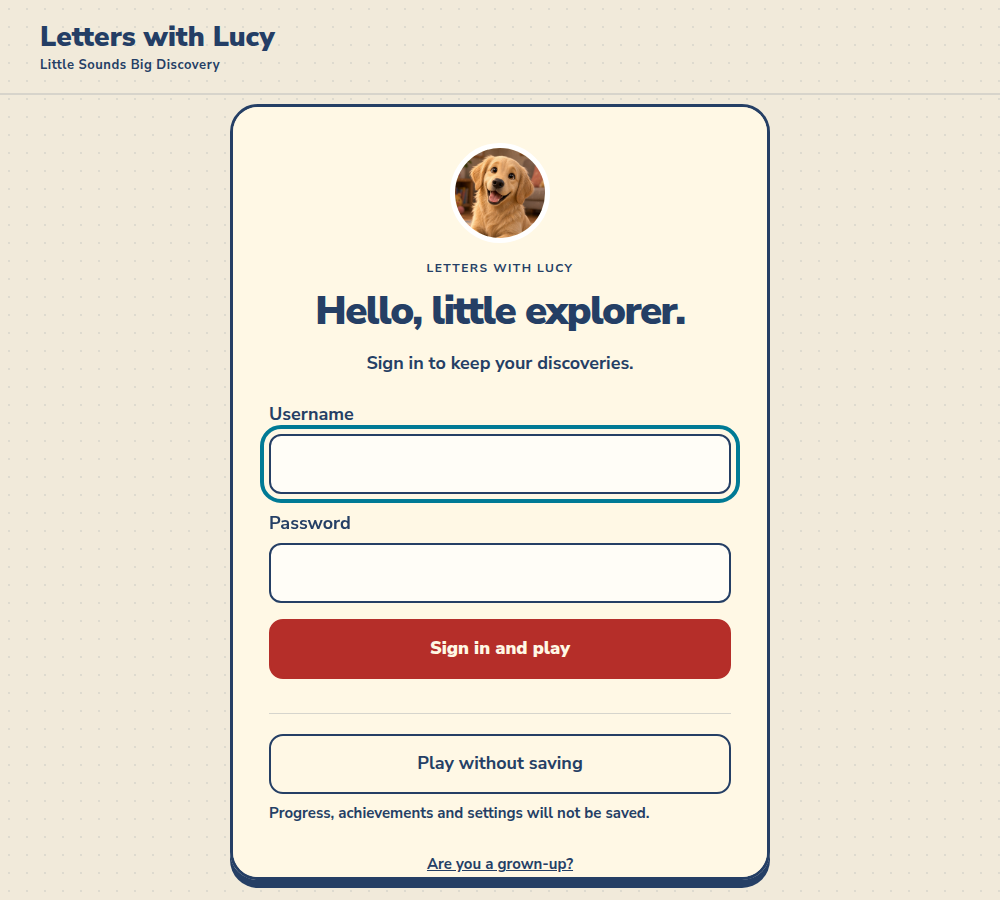
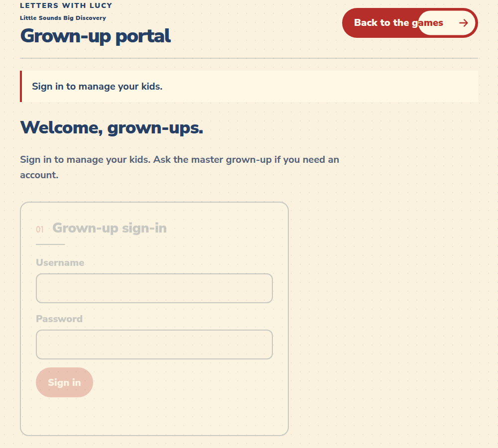
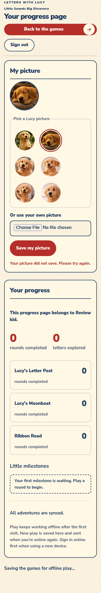

# Kid fixes review (Cursor)

Preview: https://raw.githack.com/TeslaWarpDrive/childrens-learning-game/test/kid-fixes-cursor/index.html

Merged `test/kid-fixes-codex` (Fix 1) and `test/kid-fixes-claude` (Fix 2) into this branch. The only conflict was `sw-assets.js`. Rebuilt it with `python3 scripts/build-offline-manifest.py` (version `e5753aa3adb5ce88`). No product bug needed a code change.

## Fix 1 — kid sign-out: pass

A kid who signs out from the progress page, from game settings (the existing guard sends them to their progress page first), or from the game menu lands on the site-root home screen under `/letterswithlucy/`, and the session is cleared. A grown-up who signs out from the portal or from game settings lands on the grown-up sign-in. A grown-up who signs out from the game menu still lands on the home screen; that path already went home. Destinations use the script-relative site base, not a bare `/index.html`.

## Fix 2 — kid picture picker: UI pass, live stick not run

The My picture card renders for a signed-in kid on their progress page, above Your progress, and stays hidden for a grown-up. A Lucy choice is wired to `setOwnAvatar` (`/rpc/set_own_avatar`). While that function was missing, Save showed "Your picture did not save. Please try again." and the saved picture did not change.

**Sticks after reload: not run.** Bradley applied `set_own_avatar` on `ixjbgshhzeaosrzavssr`. The live check needs a throwaway kid, and creating a kid needs a grown-up. Every recorded disposable grown-up login is gone (invalid credentials). Creating a new grown-up requires the master account. That account was not signed into, and no account was created or deleted. `tests/kid_picture_browser.cjs` still only sticks a picture against a mock backend.

## What I tested

| Check | Result |
|---|---|
| `node tests/kid_signout.cjs` (kid and grown-up, portal, settings, game menu, under `/letterswithlucy/`) | Pass, 6/6 |
| `node tests/kid_picture_browser.cjs` (card, missing function, mock save) | Pass |
| `node tests/kid_picture_database.cjs` (local PGlite only) | Pass |
| `python3 tests/run_tests.py` | Pass, 6/6 |
| Live sticks-after-reload on `ixjbgshhzeaosrzavssr` | Not run. No disposable grown-up login still works, and the master account was left alone. |

No full browser suites or shards. The live picture check stopped before any account write.

## Screenshots

- 
- 
- 
