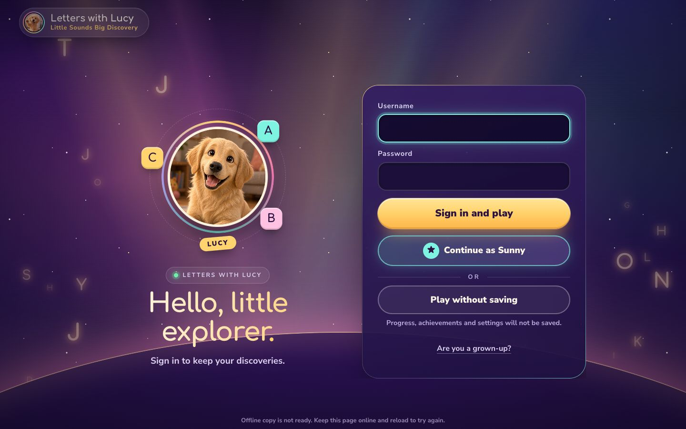
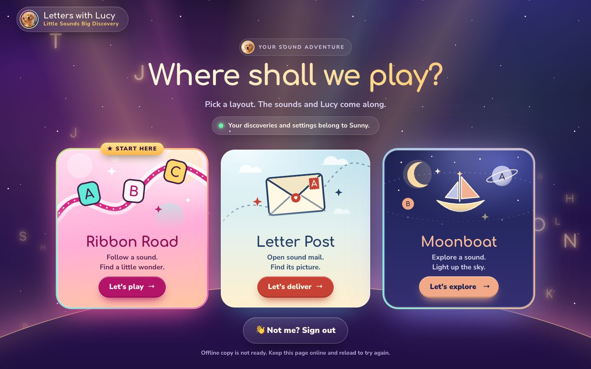
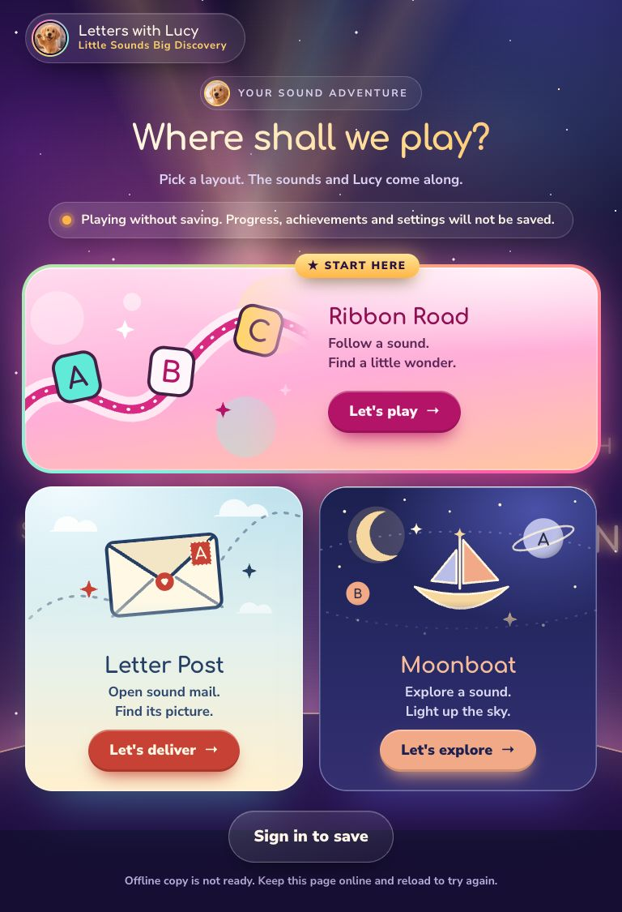
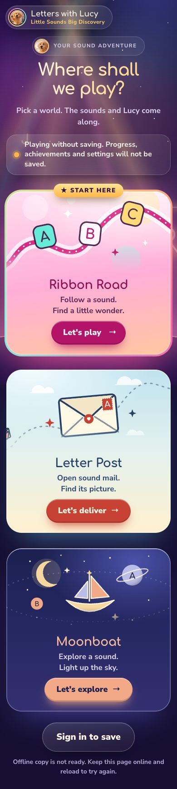

# Landing redesign: sign-in and world picker

Branch `claude/landing-redesign`, built from `codex/home-flow-ribbon` (5f76251).
Only the first two screens changed: the child sign-in and the world picker. The games, the grown-up portal, audio, the voice manifest and Supabase are untouched.

## What changed

The cream page, dotted paper, navy-outlined cards and red buttons are gone. Both screens now share one new scene: a glowing dusk sky.

- **Sign-in.** On wide screens it has two columns. Lucy sits in a glowing halo with a spinning rainbow ring and the letter tiles A, B and C orbiting her, under a gradient headline. Beside her is a dark glass panel with large rounded fields, a gold **Sign in and play** button, a teal **Continue as …** button with a star, an "or" divider, **Play without saving** and the **Are you a grown-up?** link. On tablet and phone the same pieces stack.
- **World picker.** A gradient "Where shall we play?" headline sits above a pill that shows who is playing. A green dot means saved play and an amber dot means unsaved play. Below are three bright world windows, each with its own animated scene that hints at the game behind it:
  - **Ribbon Road** has pink and peach light, a flowing ribbon, and the A, B and C tiles bobbing along it. It keeps the gold **★ Start here** badge and a spinning colour rim while it is the default. On tablets it takes a full-width featured row above the other two.
  - **Letter Post** has a sky-blue morning, drifting clouds and air-mail envelopes flying a dotted route. The big envelope with Lucy's heart seal and an "A" stamp lifts its flap on hover.
  - **Moonboat** has a deep navy night, twinkling stars, a crescent moon, letter planets and a little moon-hulled sailboat bobbing on its orbit.
- The brand is now a glass pill with Lucy's photo in a gradient ring. **Not me? Sign out** and **Sign in to save** are a large glass pill under the worlds.
- Type is Comfortaa for display, with Nunito Sans for reading. Both fonts were already in the repo.

## Effects used

All motion is transform and opacity, apart from a small dash animation in the scenes. Nothing is video and nothing is fetched.

| Effect | Where |
|---|---|
| Five slow-swaying light beams, masked so they fade top and bottom | Sky |
| Three drifting aurora glows, a breathing central glow, two twinkling star layers and a rim-lit planet horizon | Sky |
| Rising letter lanterns (9 on phones, up to 18 on desktops) with a warm glow and sideways sway | Sky |
| Pointer parallax: beams, aurora, stars and lanterns shift by depth, and a soft spotlight follows the mouse | Sky (mouse only) |
| A light bloom flash when the picker opens | Sign-in → picker transition |
| Staggered entrance; cards below the fold rise in as they scroll into view | Sign-in panel, picker |
| Halo pulse, spinning conic ring, orbiting tiles that stay upright, and a head tilt on hover | Lucy |
| A shimmering gradient on the headlines, and a light sweep across the gold button every few seconds | Text and buttons |
| 3D tilt toward the pointer, a glare that follows the cursor, parallax layers inside each scene, lift and glow, a spinning colour rim and a sliding arrow | World windows |
| A tap on open sky sends up a little burst of letters and stars | Both screens (small details that reward a second look) |

**Calm version.** With `prefers-reduced-motion` or the grown-ups' **calm** setting, every animation and transition stops. The same scene shows standing still, with no tilt, parallax, bloom or bursts, and lanterns move to the side margins so none rests on the words.

**Smoothness.** In Chrome with the CPU throttled 4×, both screens held 60 fps at 1366×768 and 390×844, with the picker hovered and no frames over 33 ms. Large glass panels skip `backdrop-filter`, so moving sky behind them costs nothing extra.

## Behaviour kept

All IDs, links and logic the rest of the app relies on are unchanged: `#login-dialog`, `#child-signin-form`, `#continue-player`, `#play-unsaved`, `.grown`, `#layouts`, `#layout-picker [data-world]`, `aria-current`, `#saving-notice`, `#change-player` and `#offline-status`. `home/home.js` gained only two attributes (`data-count` on the picker and `data-kind` on the notice) and one event (`home:layouts`) for the effects. Decorative code lives in the new `home/effects.js`, which never touches accounts or storage. Ribbon Road is still first and the default. Grown-up layout visibility still applies when signed in, and unsaved play still shows all three. Every control on the sign-in is at least 60px tall, and the picker still fits a 1024×768 or 1366×768 screen without scrolling. The offline manifest was rebuilt with `scripts/build-offline-manifest.py` and now includes `home/effects.js`. No new image or font files were added.

## Screenshots

The "after" set uses reduced motion, so every card shows. The fake player is the local mock child "Sunny".

| Size | Sign-in (before → after) | Returning child | Picker, unsaved | Picker, signed in |
|---|---|---|---|---|
| Phone 390×844 | [before](landing-redesign/before-phone-1-signin.jpg) → [after](landing-redesign/after-phone-1-signin.jpg) | [before](landing-redesign/before-phone-2-signin-returning.jpg) → [after](landing-redesign/after-phone-2-signin-returning.jpg) | [before](landing-redesign/before-phone-3-picker-guest.jpg) → [after](landing-redesign/after-phone-3-picker-guest.jpg) | [before](landing-redesign/before-phone-4-picker-signedin.jpg) → [after](landing-redesign/after-phone-4-picker-signedin.jpg) |
| Tablet 768×1024 | [before](landing-redesign/before-tablet-1-signin.jpg) → [after](landing-redesign/after-tablet-1-signin.jpg) | [before](landing-redesign/before-tablet-2-signin-returning.jpg) → [after](landing-redesign/after-tablet-2-signin-returning.jpg) | [before](landing-redesign/before-tablet-3-picker-guest.jpg) → [after](landing-redesign/after-tablet-3-picker-guest.jpg) | [before](landing-redesign/before-tablet-4-picker-signedin.jpg) → [after](landing-redesign/after-tablet-4-picker-signedin.jpg) |
| Desktop 1440×900 | [before](landing-redesign/before-desktop-1-signin.jpg) → [after](landing-redesign/after-desktop-1-signin.jpg) | [before](landing-redesign/before-desktop-2-signin-returning.jpg) → [after](landing-redesign/after-desktop-2-signin-returning.jpg) | [before](landing-redesign/before-desktop-3-picker-guest.jpg) → [after](landing-redesign/after-desktop-3-picker-guest.jpg) | [before](landing-redesign/before-desktop-4-picker-signedin.jpg) → [after](landing-redesign/after-desktop-4-picker-signedin.jpg) |

With motion on: [sign-in](landing-redesign/motion-desktop-1-signin.jpg), [picker](landing-redesign/motion-desktop-3-picker-guest.jpg), [Ribbon Road hovered at 1366×768](landing-redesign/motion-hover-1366.jpg).






The "Offline copy is not ready" line in the screenshots appears only because the capture blocked service workers. A normal visit shows "Games ready for offline play."

## Preview locally

```sh
cd childrens-learning-game
git checkout claude/landing-redesign
python3 -m http.server 8000
```

Open http://localhost:8000/. **Play without saving** works with no account. Opening `index.html` straight from the folder also works for unsaved play. To see the calm version, turn on "Reduce motion" in the operating system, or the grown-ups' calm setting.

## Tests

Run on macOS Chrome with the repository's local mock backend. As an extra guard, browser DNS for `*.supabase.co` was blackholed during runs. No accounts were created or touched and no live requests were made.

- `python3 tests/run_tests.py` passed **6/6** strict checks.
- These passed: `home_flow` (390/768/1440, signed out, signed in, unsaved, offline reload, local file), `fix24_layout` (sign-in has no scroll and every control is at least 60px; picker fits 1024×768 and 1366×768), `grown_ups_smoke`, `portal_flow`, `kid_signout`, `guest_link_flag`, `accounts_sync`, `fixlist`, `offline_readiness`, `layout_offline`, `lucy_letters_offline`, `call_list_offline`, `failed_precache_cache`, `first_takeover_reload`, `runtime_smoke`, `grown_ups_runtime`, `moonboat_theme_color`, `layout_build`, `update_round_guard`, `takeover_round_race`, `progress`, `progress_sync`, `profile_picture_dirty`, `profile_rename_race`, `risky_actions_browser`, `portal_review_browser`, `kid_picture_browser`, `name_only_picture_refresh`, `picture_swap`, `cancelled_press`, `celebrate_audio_rules`, `celebrate_delay`, `correct_word`, `fade_swap`, `call_list_sounds`, `tidy_1`, `tidy_1b`, `browser_smoke` (all 6 shards), `motion_smoke` and `confetti_smoke`.
- Five tests fail **identically on the untouched `codex/home-flow-ribbon`** on this Mac, so they are not caused by this change. They are `silk_smoke` (Ribbon Road's 56px theme menu), `layout_ribbon_unchanged` (pixel comparison), `call_list_browser`, `lucy_letters` (image bytes) and `tidy_1_update` (update takeover). They look specific to macOS rendering, since the suite targets Linux Chrome.
- Not run: the `*_live`, `*_hosted`, `portal_master*`, `portal_round2`, `child_settings_browser`, `accounts_selection` and `master_login` suites, which create or use real accounts, and the `*_database` and `*_edge` suites, which need the local `.job/db-tools` that isn't in the repository.
- **One test edit.** `tests/portal_flow.cjs` used to assert that the home page's body colours equal the grown-up portal's cream chrome. That is the old cream-chrome lock, which this redesign lifts for these two screens. The check now compares the portal with the settings page only. Everything else in that test, including the grown-up link, is unchanged.

## Questions for Bradley

1. **Test edit.** Is it OK that `tests/portal_flow.cjs` no longer requires the child home to match the grown-up portal's cream look? Your brief lifts that lock for these two screens, but it's the only test I changed.
2. **Dark home, light games.** The new home is a dusk sky, while Ribbon Road and Letter Post open bright, so each world feels like stepping through a window. Is that jump what you want, or should the sky lighten toward the picked world as it opens?
3. **Wording.** I kept the existing copy, including "Pick a layout. The sounds and Lucy come along." Would you like the picker to say "world" instead of "layout", or any new lines for Lucy?
