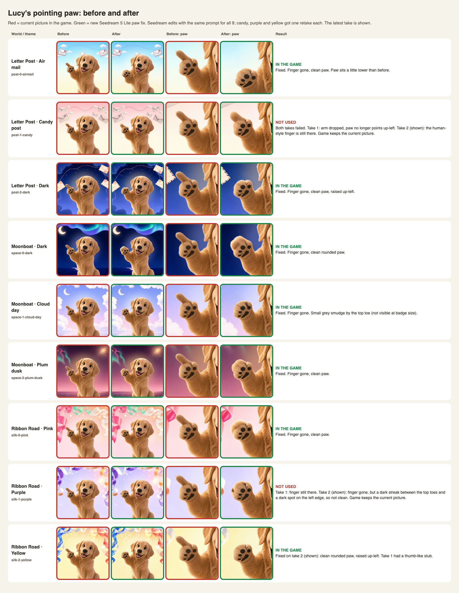
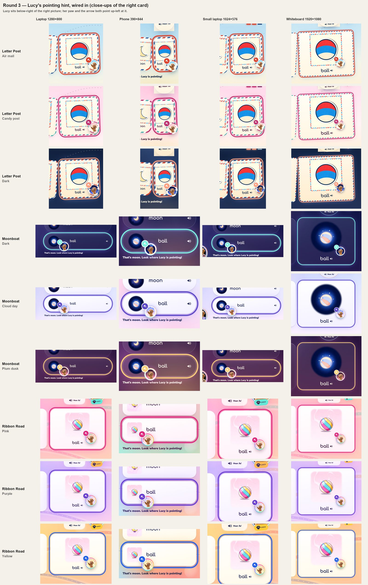
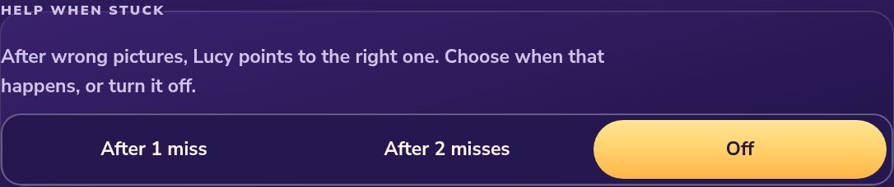
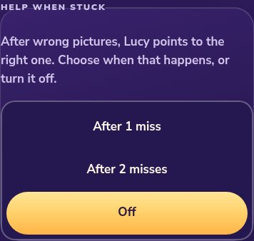
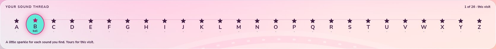
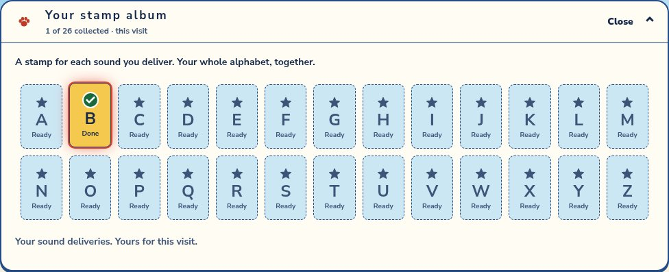
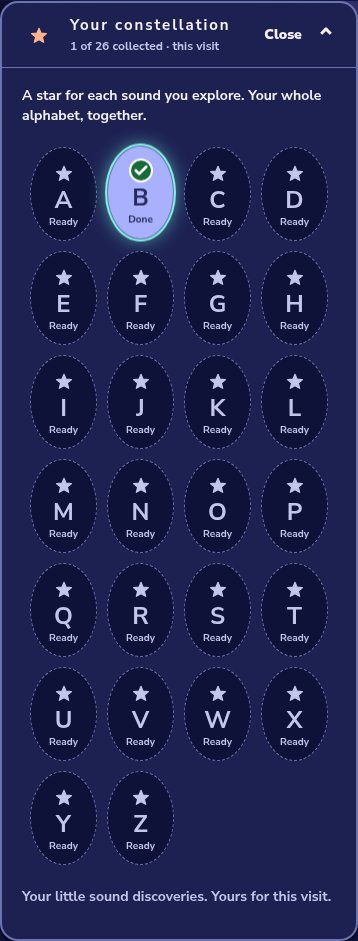
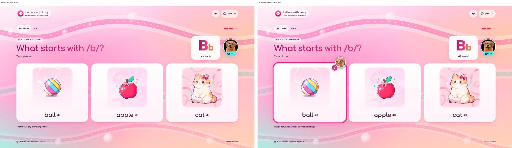
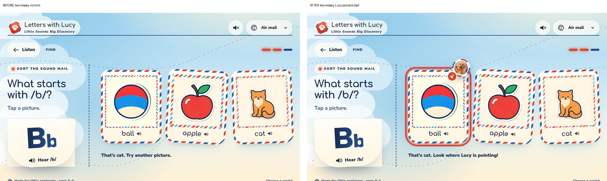
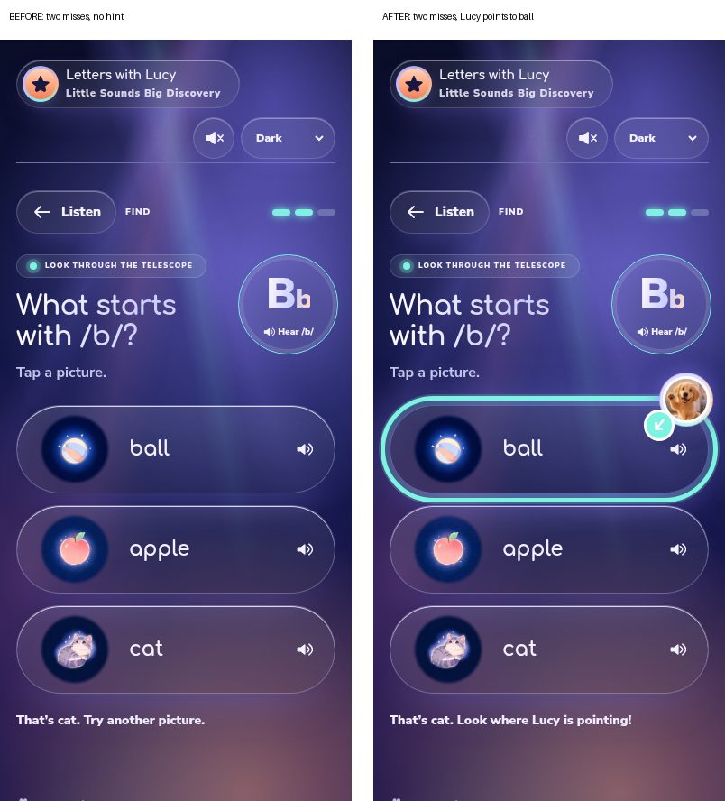

# Lucy points to the answer, grown-ups choose when, and collected letters play again

Branch `claude/lucy-hint`, built on `claude/fullsite-redesign` (5e8992f). There have been five passes so far, plus a paw fix on its own branch:

- **Paw fix (branch `claude/lucy-paw-fix`, from `claude/lucy-hint` 12e1853)** takes the human-style finger off Lucy's pointing paw in 7 of the 9 pictures.
- **Round 5 (Bradley's round 4 brief)** changes the hint's words and makes Lucy bigger on whiteboards.
- **Round 4** wires in the approved pointing-Lucy pictures, one per world and theme.
- **Round 3** followed Bradley's answers to the three questions from round 2.
- **Round 2** brought back the grown-ups' hint setting and added collection replay.
- **Round 1** added the pointing hint and deleted the Ribbon Road lock test.

Nothing was deployed or merged, and no live account or live data was touched. No sound was added or changed.

## Paw fix: a dog paw, not a finger

Bradley: "Lucy can point with her paw, but she doesn't have a long finger to point. She's not a human. So it just needs to be the paw."

- **How:** one Seedream 5 Lite edit per picture (flow `yuQAe0hoTg2oErjfSE3P`, new "Paw fix …" nodes; no existing node changed). Each edit used that picture's round-2 master as its reference and the same paw-only prompt Bradley approved on the first picture. The runs went from Bradley's Mac Chrome with his VPN on, because the connector itself is region-blocked.
- **In the game now (7):** `post-0-airmail-paw`, `post-2-dark-paw`, `space-0-dark-paw`, `space-1-cloud-day-paw`, `space-2-plum-dusk-paw`, `silk-0-pink-paw`, `silk-2-yellow-paw`. Each is a new 256 × 256 WebP in `accounts/lucy/pointing/`, 7–10 KB. Lucy's paw still points up-left. The finger is gone and the pads are the same.
- **Retakes:** Bradley approved one retake each for candy, purple and yellow, with the same prompt. Yellow came out clean on the second take: its first take left a short thumb-like stub.
- **Not used yet (2):** each of these keeps its current picture until a better take exists.
  - `post-1-candy`: on take 1 her arm dropped and her paw no longer pointed up-left. On take 2 the finger is still there.
  - `silk-1-purple`: on take 1 the finger was still there. Take 2 removed it, but it left a dark streak between the top toes and a dark spot on the paw's edge.
- **Kept:** the old pictures stay in place, and nothing was overwritten.
- **Changed files:** `v1-letter-post/hint.js` (the picture list), `tests/lucy_hint.cjs` (the expected names) and `sw-assets.js` (rebuilt so the new pictures work offline).



## Round 5: the hint's words and whiteboard Lucy

Bradley on the old line, "That's moon. Look where Lucy is pointing!": "This text here for hints. Get rid of it." / "It says moon" / "But thats a ball", then "You can keep the text, just make it say Hint or heres a hint but give claude the freedom to choose how thats worded". On whiteboard size: "Claudes choice". On the word stepping aside: "The word shift is fine". On the tidy_1 test: "Skip the test fix".

- **The line.** Once Lucy points, the feedback line is only **"Here’s a hint! Look where Lucy is pointing."** It no longer starts with "That’s <tapped word>.", because the tapped card is never the one Lucy points at. It is the same in every world and theme, and it fits on one line on a 390 px phone. Before Lucy points (the first miss, or with Help when stuck off), the line is unchanged: "That’s moon. Try another picture." The wording is the `line` string in `v1-letter-post/hint.js`, and both game engines (`v1-letter-post/app.js`, `v3-moonboat/app.js`) now show it on its own.
- **Whiteboard size.** Lucy's ring is now `clamp(60px, min(6vw, 11vh), 120px)`: about 115–119 px on a 1920 × 1080 whiteboard (it was capped at 88 px), and unchanged on phones (60 px), small laptops (61–64 px) and laptops (77–79 px). The height term keeps her from growing on short, wide screens. Placement still keeps her paw and arrow on one line through the right picture, covering nothing.
- **Word shift** and `tests/tidy_1.cjs` are unchanged, as Bradley said.
- **Tests:** `runtime_smoke`, `grown_ups_runtime` and `lucy_hint` now require the hint line exactly, so a card name can't creep back in.
- Checked in all 9 world/theme combinations at 1280 × 800, 390 × 844, 1024 × 576 and 1920 × 1080: the line names no card, and Lucy overlaps nothing and causes no sideways scroll.

## Round 4: the pointing Lucy, wired in

Bradley approved the pointing pose ("This one nailed it") and all 9 on-brand backgrounds ("All 9 backgrounds are good"). He left the badge placement and the Moonboat sound-button overlap to Claude, with one hard rule: "if you're using an arrow, both the arrow and Lucy need to be pointing at the same thing."

### The pictures

- 9 new files in `accounts/lucy/pointing/`, 256 × 256 WebP, 8–12 KB each: `post-0-airmail`, `post-1-candy`, `post-2-dark`, `space-0-dark`, `space-1-cloud-day`, `space-2-plum-dusk`, `silk-0-pink`, `silk-1-purple`, `silk-2-yellow`.
- Each is the same approved Lucy, pixel for pixel, on that world's own backdrop. No new image was generated for this pass.
- `hint.js` picks the one for the current world and theme, and swaps it at once if the theme changes while Lucy is showing.
- `accounts/lucy/wave.jpg` is untouched. It is still the header's brand picture, and the hint falls back to it only in a world with no pointing set.

### Where Lucy sits: paw and arrow point at the same picture

- Lucy's paw points up-left, so she now sits **just below and to the right of the right picture itself**, wherever the card layout puts that picture: under it in Letter Post and the tall Ribbon Road cards, and beside it in the Moonboat and phone Ribbon Road rows.
- The arrow sits on her ring on the paw's side and is turned to the same up-left angle, so both point along one line. `hint.js` only uses spots where that line runs through the middle of the picture.
- Among those spots it picks one that covers no word, sound button, other picture or feedback line and stays on screen. It then prefers the spot that covers the least of the drawing and stays closest.
- It re-checks when Lucy appears, when the pictures come back after Listen, when the theme changes and when the card changes size (rotation or resizing).
- **Moonboat's sound button:** Lucy now sits next to the picture at the left end of the row, far from the 🔊 at the right end, so they can no longer overlap.
- **Tight cards:** on Letter Post phones and in Moonboat rows, the card's word steps aside a few pixels so that Lucy covers neither the picture nor the word. In Moonboat the word moves right and the 🔊 stays put. In Letter Post the word moves left. Only the card Lucy is on changes.



### Files (round 4)

| File | Change |
|---|---|
| `accounts/lucy/pointing/*.webp` | New. The 9 pointing-Lucy pictures. |
| `v1-letter-post/hint.js` | Picks each world and theme's picture, places Lucy below-right of the right picture, and keeps her placed and in theme. |
| `v1-letter-post/worlds.css` | The arrow points up-left like her paw; the fallback corner is now the card's bottom-right; the word can step aside. |
| `sw-assets.js` | Rebuilt with `scripts/build-offline-manifest.py`, so the 9 pictures work offline. |
| `tests/lucy_hint.cjs` | Checks the picture per world and theme (including theme changes), that Lucy is below-right with her pointing line through the picture, that the arrow points the same way, and that she covers nothing and stays on screen. |
| `README.md`, `reports/lucy-hint.md`, `reports/lucy-hint/pointing-wired.jpg` | This note and its contact sheet. |

No audio clip, `audio-map.js` or `voice-manifest.json` was touched.

## Round 3: Bradley's answers

| Question | Bradley's answer | What this pass did |
|---|---|---|
| 1. Lucy-pointing pictures | "Tell it to try again. I have turned on the VPN for china so it should work now." | Tried again. **Still refused:** "This model is not available in your region." Nothing was generated and no credits were spent. Per the instructions, no other model was tried. See question 1. |
| 2. Old "off" hint values | "Claudes decision on what a game like this should do is fine" | Decided to **keep a grown-up's saved choice**. No code change. The reasons are below. |
| 3. What a tap on a collected letter does | "Start that letter's round again" | Done. Tapping a collected letter in any world's collection now starts that letter's round, exactly like its card on the letter shelf. |

### Lucy-pointing pictures: tried again, still blocked

- **What I ran:** the ready node **"HINT paw-point A"** (node `wzfTeDWF1pXD9VAw6VOW` on flow `yuQAe0hoTg2oErjfSE3P`), through the "claude.ai ElevenLabs" connector only.
  - Before running, I checked that the node was still exactly as round 2 left it: Seedream 5 Lite (`bytedance-seedream-5-lite`), 2K, 1:1, edit of `lucy-locked-garden-b`, all 9 approved references, and the recipe prompt.
- **The result:**
  - The cost check returned `blocking_errors: ["Node 'HINT paw-point A': This model is not available in your region."]`.
  - I then started the real run once, for 4 variations, which is within what was approved. It was refused with the same message.
- **Afterwards:** the node shows no generations, so nothing was made and nothing was charged. The node is unchanged and still ready to run.
- **Why the VPN probably didn't help:** this is a likely cause, not a confirmed one. The connector's requests go to ElevenLabs from Anthropic's servers, not from Bradley's computer. A VPN on his machine changes where *his* browser appears to be, not where the connector's requests come from.
  - Opening the flow in a browser while the VPN is on would send the request from his machine instead. That may work. See question 1.
- **What did not happen:**
  - No other model or connector was tried.
  - No image was saved or wired in, and no Lucy file was touched.
  - The game still uses the placeholder `accounts/lucy/wave.jpg`.
  - `reports/lucy-hint/pointing-candidates/` was not created, because there is nothing to put in it.
- **Recommendation:** none yet, because there are no candidates. When there are, I'll save each one as a new file in `reports/lucy-hint/pointing-candidates/` with a contact sheet next to the approved Lucy pile.
  - I'll check each one for drift: a younger or rounder face, bigger eyes, a shorter muzzle, different fur or markings, a second puppy, accessories or an orange tint.
  - I'll also check that the paw clearly reads as pointing inside a 60–88 px circle, and recommend one. Wiring it in stays a one-line change to `image` in `v1-letter-post/hint.js`, after Bradley picks.

### Old "off" hint values: kept as the grown-up chose

**The decision:** if a grown-up saved "off" for the old hint, it stays off until a grown-up changes it in Game settings → 02 Letters → **Help when stuck**. Everyone else gets the default, Lucy pointing after 2 misses. Nothing changed in the code. This is how round 2 already worked.

**Why this is right for a children's learning game:**

1. **It is the same choice.** The old setting was "Don't outline", which meant "don't show my child which picture is right." The new **Off** means the same thing: Lucy doesn't point to the answer. So the grown-up's saved choice still means what they chose.
2. **Only a grown-up ever chose 0.** The default has always been 2, in every version of `grown-ups/settings.js` and in the database's starting value, so a stored 0 always means a grown-up deliberately chose it. Some grown-ups turn help off on purpose, for example a teacher checking what a child knows without help, or a child who taps through hints. A children's app shouldn't quietly undo a parent's or teacher's choice.
3. **It is easy to see and change.** The choice now shows as **Off** in Game settings and can be changed with one tap. For chosen children it shows in "Review changes" like every other setting.
4. **A reset would mean changing live accounts.** The stored value only allows 0, 1 or 2 (`supabase/migrations/20261019060259_accounts_sync.sql`), and the old and new "off" look the same. Telling them apart would need a one-time reset of every account's saved value, or a new database field. Both mean a database change on live accounts, which is outside this lane, for little gain.
5. **No child is worse off than before.** While the setting was hidden (from the Oct 21 tidy-up until round 1), every child played with no hint at all. Children whose grown-ups never chose "off" now get Lucy's help. Children whose grown-ups did choose it play as they did before.

### Collection tap starts the round again

- **What it does:**
  - In every world's collection, a collected letter is still a button.
  - Tapping it now starts that letter's round: the listen screen, its name and sound, three pictures, the hint if the child gets stuck, and the reward.
  - It is the same `start()` call the letter's card on the shelf uses, so the round is identical.
- **Where it works:**
  - **Letter Post and Moonboat:** the stamp album and the constellation, after tapping **Open**.
  - **Ribbon Road:** the sound thread, on the home page and on the reward screen.
- **Progress:** playing a collected letter again keeps it collected, and the count doesn't go up. The test checks it stays "1 of 26".
  - For signed-in children, a replayed round saves like any replayed round from the shelf, which the existing `progress_sync` suite already covers.
- **What's gone:** the in-place replay of name, sound and word, and the small stamp wiggle that went with it. The child now leaves the home page, so a wiggle would never be seen.
- **Unchanged:**
  - Letters not yet collected stay plain and can't be tapped.
  - The collections look exactly the same, including the hover lift, the focus ring and the 60 px touch target from round 2. The round 2 replay screenshots still show them accurately.
- **Keyboard and screen readers:** Tab to the letter and press Enter. Screen readers now hear, for example, "B, completed this visit. Play B again" (it used to say "Hear B again").
- **Sounds:** only the round's existing clips. Nothing was added.

### Files (round 3)

| File | Change |
|---|---|
| `v1-letter-post/app.js`, `v3-moonboat/app.js` | A collected letter (`data-again`, renamed from `data-hear`) calls `start()`, like its shelf card. `hear()` and its wiggle are removed. The label is now "Play B again". |
| `v1-letter-post/layout.js` | The Letter Post and Moonboat album uses the same `data-again` attribute and label. Its comment is updated. |
| `v1-letter-post/worlds.css` | Comment only. |
| `sw-assets.js` | Rebuilt offline list version (same files). |
| `tests/collection_replay.cjs` | Now checks that a tap, and Enter, starts B's round, and that B stays counted once. |
| `tests/verify-game/features/home.md` | Describes the new tap. |
| `reports/lucy-hint.md` | This report. |

**Locked and unchanged:** every audio clip, `audio-map.js`, `voice-manifest.json` and `approved/`. `git diff d429e5a -- audio audio-map.js voice-manifest.json approved '*.mp3'` is empty. Every Lucy and picture image is also unchanged.

### Tests (round 3)

All tests ran in a Linux container using Google Chrome (`CHROMIUM_EXECUTABLE=/usr/bin/google-chrome`) and local fixtures or the mock backend, with external requests blocked. No live account or data was touched. Heavy suites ran one at a time because of the shared 16 GB machine.

- **`python3 tests/run_tests.py`** passed **6/6** strict checks: approved audio hashes, trim metadata, wiring, voice inventory, A–Z and themes.
- **Audio lock:** `git diff d429e5a -- audio audio-map.js voice-manifest.json approved '*.mp3'` is empty.
- **Updated `tests/collection_replay.cjs`** passes all **18** combinations: 3 worlds × 3 sizes (390×844, 1024×576, 1920×1080), each with and without calm. It passed in full twice. In each combination it checks that:
  - nothing is replayable before a letter is collected
  - the collected letter is a button labelled "B, … this visit. Play B again", and the other 25 stay plain
  - nothing overflows sideways
  - a tap opens **B's** listen screen and plays B's name and sound, exactly as any round starts
  - the round then gives three pictures, a correct tap reaches the reward, and the count stays **1 of 26**
  - the same is true with Enter from the keyboard
  - there are no page errors
- **Other suites that pass:** `lucy_hint` (33/33), `progress`, `progress_sync`, `fixlist`, `layout_build`, `silk_smoke` (including the 60 px touch targets), `offline_readiness`, `layout_offline`, `grown_ups_smoke`, `grown_ups_runtime`, `runtime_smoke`, `tidy_1`, `home_flow`.
- **`browser_smoke`:** shards 1 and 5 pass. Shards 0, 2, 3 and 4 fail on this machine, and **the untouched round-2 commit `d429e5a` fails the same way**. I ran it in a separate worktree, and its shards 0, 2 and 4 failed with 0–1 cases passing.
  - These shards play the real mp3 files, and every failure is either a "Stalled playback" wait or an "element is not stable" timeout on the shelf → listen → pictures → reward path. That path is unchanged in this pass, and the suite never taps a collected letter.
  - The stalls land on a different clip each time: a retry clip, a word, a letter name or a cheer. In each case headless Chrome never reported the file as finished.
  - Round 2 saw one such stall (`word-van.mp3`). Today it happens on most runs, so it looks like the machine's headless audio, not the code.
- **My mistakes while running these:**
  - The first `browser_smoke` loop was started without a long enough time limit, and it was stopped at 10 minutes.
  - For about a minute, a second loop overlapped it before I stopped that one. Shard 1 passed during that overlap.
  - Every result listed above comes from runs made one at a time after that.
- **`collection_replay`** failed once on its very first run, with the same "element is not stable" timeout on the listen screen's "Find its picture" button. That was before any collection tap. It then passed in full twice.
- **Not run**, as before:
  - Suites that use real accounts: `*_live`, `*_hosted`, `portal_master*`, `portal_round2`, `child_settings_browser`, `accounts_selection`, `master_login`.
  - The `*_database` and `*_edge` suites, which need `.job/db-tools`.
  - `lucy_letters`, which ran out of memory before.
  - The four suites that already failed on `cbf53f3`: `motion_smoke`, `confetti_smoke`, `tidy_1_update`, `call_list_browser`.
- **Report artifacts:** suites rewrite old report screenshots and logs as they run. Those changes were thrown away and are not in this commit.

## Round 2: Bradley's answers

| Question | Bradley's answer | What this pass did |
|---|---|---|
| 1. Lucy-pointing pictures | "Have Claude choose the best" | Chose concept A, the paw point, and set it up with the approved recipe. **Nothing generated:** the ElevenLabs connector says the recipe's model (Seedream 5 Lite) "is not available in your region" from here. See question 1. The game still uses the placeholder. |
| 2. Collection replay | "Yes, build collection replay" | Built. Tapping a collected letter in the collection says it again. |
| 3. Grown-ups can change the hint | "Yes, grown-ups can change or turn off the hint" | Brought back **Help when stuck**: after 1 miss, after 2 misses (the default) or off. |
| 4. Voice line | "No voice line" | None. The optional line is dropped from AUDIO NEEDED. |
| 5. "Look where Lucy is pointing!" | "Yes but depending on if it's too much we can back it out." | Kept. It is now one string in `v1-letter-post/hint.js`, so backing it out is a one-line change. |
| 6. Leftover test output | "Delete the leftover test output" | Deleted `reports/layout-build/ribbon-unchanged.json`. |
| 7. This report | "Keep the report file" | Kept and updated. |

### Help when stuck (grown-ups' setting)

- **Where it is:** Game settings → **02 Letters**, under the letter grid. It has three choices: **After 1 miss**, **After 2 misses** and **Off**.
- **Default:** after 2 misses, the same as round 1.
- **How it's stored:** it reuses the old stored value, `hintAfter` (0 = off, 1 or 2). Accounts never stopped syncing it, the database already accepts only 0, 1 or 2, and reset already returns it to 2. There is no database or account change.
  - Any value saved before the tidy-up, when this setting last existed, now takes effect again. If a grown-up chose "Don't outline" back then, that child gets no hint until it is changed here.
- **Children:**
  - It works like every other setting. For game defaults it saves at once.
  - For chosen children it goes through "Review changes", where it reads, for example, "Help when stuck → Off".
  - If the selected children have different values, it shows as mixed.
- **In the game:**
  - The hint now reads the setting through `LucyHint.after` in `hint.js`.
  - **After 1 miss:** Lucy points after the first wrong picture.
  - **Off:** every miss says "Try another picture."
  - The sounds are the same in every case: the tapped word, a pause, then one of Lucy's existing retry clips.

### The hint line is one string

`v1-letter-post/hint.js` now has a `line` string set to `'Look where Lucy is pointing!'`. Both game engines read it. Setting it to `null` backs the line out, and the feedback goes back to "That's cat. Try another picture." Lucy still points either way.

### Collection replay

> **Changed in round 3:** a tap now starts that letter's round again, rather than saying its sounds in place. See [Round 3](#round-3-bradleys-answers). This section records what round 2 built.

- **What it does:**
  - In every world's collection, each collected letter is now a button.
  - Tapping it plays the same three clips the round uses: the letter's name, its sound, a short pause, then its word. For B that is "B", /b/, "ball".
  - The child stays on the home page.
  - The stamp gives a small wiggle, using transform only. Under calm or reduced motion it stays still.
- **Where it works:**
  - **Letter Post and Moonboat:** in the stamp album and the constellation, after tapping **Open**.
  - **Ribbon Road:** on the sound thread, on the home page and on the reward screen.
- **Unchanged:**
  - Letters not yet collected stay plain and can't be tapped.
  - The collections look the same as before. The only visual difference is a hover lift and a focus ring on collected letters.
  - It works by keyboard too: Tab to the letter, then press Enter. Screen readers hear, for example, "B, completed this visit. Hear B again".
- **Voice off:** if a grown-up turned Lucy's voice off, the tap stays quiet, as every other sound in the game does.
- **Sounds:** it only reuses the existing letter and word clips. No sound was added.

### Lucy-pointing pictures: chosen, set up, not generated

- **Which concept I chose: A (paw point).** At the badge's size (60–88 px, in a circle) a raised paw reaching down-left reads as pointing most clearly.
  - **B (nose point):** at that size it looks like sniffing.
  - **C (blue glasses):** it adds an accessory, and the recipe says no accessories.
  - **D (one picture per world):** it would need extra code and three times the images.
- **How it's set up:** following the recipe exactly, on the recipe's flow `yuQAe0hoTg2oErjfSE3P`, using only the "claude.ai ElevenLabs" connector:
  - I copied the existing approved 1:1 cutout node ("B try 1"), so the new node keeps the same model, 2K, 1:1, the edit base `lucy-locked-garden-b` and all 9 approved references.
  - The copy is labelled **"HINT paw-point A"** (node `wzfTeDWF1pXD9VAw6VOW`).
  - Its prompt is the recipe prompt word for word, with only the pose and setting changed: "Lucy sits facing the viewer and points helpfully with one front paw raised and stretched out toward the lower left corner of the image … plain soft light cream studio backdrop … head and pointing paw centred … so she still reads clearly inside a small circle".
  - Four variations were set up. No other node on the flow was touched.
- **What stopped it:** the cost check returned `This model is not available in your region.` The recipe says changing the model needs your OK, so I stopped there.
  - No images were made and no credits were spent.
  - No other model or connector was tried.
- **What stays the same:** no Lucy file was touched, and the game still uses the placeholder `accounts/lucy/wave.jpg`.
- **Image candidate paths:** none yet. When they exist, they go in a new folder, `reports/lucy-hint/pointing-candidates/`, with a contact sheet. Wiring the chosen one in stays a one-line change to `image` in `hint.js`, after you pick.

### Files (round 2)

| File | Change |
|---|---|
| `v1-letter-post/hint.js` | `after` comes from the grown-ups' setting (0 = off), a new `due(misses)` check, and the `line` string. The voice slot stays empty. |
| `v1-letter-post/app.js`, `v3-moonboat/app.js` | The hint uses `hint.due()` and `hint.line`. Collected letters in the Ribbon Road thread are buttons. New `hear()` for collection replay. Focus is kept when the collection refreshes. |
| `v1-letter-post/layout.js` | Collected letters in the Letter Post and Moonboat album are buttons. Focus is kept on refresh. |
| `v1-letter-post/worlds.css` | Pointer, hover lift and focus ring for collected letters. The hint comment mentions the setting. |
| `grown-ups/index.html`, `editor.js`, `grown-ups.css`, `dusk.css` | The Help when stuck control. Its label and summary for "Review changes", and its pill in the dusk colours. |
| `sw-assets.js` | Rebuilt offline list version (same files). |
| `reports/layout-build/ribbon-unchanged.json` | Deleted. |
| `tests/collection_replay.cjs` | New (see Tests). |
| `tests/lucy_hint.cjs` | Adds Help when stuck at 1 miss and off, in every world, and checks the line string. |
| `tests/grown_ups_smoke.cjs`, `tests/grown_ups_runtime.cjs` | These had locked in "no hint setting". They now expect the control, its default, saving, reset, and its effect in the worlds. |
| `tests/verify-game/features/*.md` | Describe the setting, the line string and collection replay. |
| `reports/lucy-hint.md`, `reports/lucy-hint/help-when-stuck-*.jpg`, `replay-*.jpg` | This report and its screenshots. |

**Locked and unchanged:** every audio clip, `audio-map.js`, `voice-manifest.json` and `approved/`. `git diff cbf53f3 -- audio audio-map.js voice-manifest.json approved '*.mp3'` is empty. Every Lucy and picture image, the world names and the celebration are also unchanged.

### Screenshots (round 2)

| What | Image |
|---|---|
| Help when stuck, whiteboard (Off chosen) |  |
| Help when stuck, phone |  |
| Ribbon Road thread with B collected |  |
| Letter Post stamp album with B collected |  |
| Moonboat constellation with B collected (phone) |  |

### Tests (round 2)

All tests ran in a Linux container using Google Chrome and local fixtures or the mock backend, with external requests blocked. No live account or data was touched. Heavy suites ran one at a time because of the shared 16 GB machine.

- **`python3 tests/run_tests.py`** passed **6/6** strict checks: approved audio hashes, trim metadata, wiring, voice inventory, A–Z and themes.
- **Audio lock:** `git diff cbf53f3 -- audio audio-map.js voice-manifest.json approved '*.mp3'` is empty.
- **New `tests/collection_replay.cjs`** passes all **18** combinations: 3 worlds × 3 sizes (390×844, 1024×576, 1920×1080), each with and without calm. In each one it checks that:
  - nothing is replayable before a letter is collected
  - the collected letter is a button with the right label, and the other 25 stay plain
  - a tap plays exactly `b-name-trim.mp3`, `b-sound-trim.mp3`, `word-ball.mp3`
  - the wiggle uses transform only, and nothing moves under calm
  - the child stays on home, nothing overflows sideways, Enter works from the keyboard, and there are no page errors
- **`tests/lucy_hint.cjs`** passes **33/33**:
  - round 1's 27 combinations
  - plus Help when stuck at **1 miss** (Lucy points after one miss, with the line) and **off** (no hint after two misses, "Try another picture."), in each world
  - plus a check that the line is the one `LucyHint.line` string
  - The usual retry clip still plays in every case.
- **Updated:**
  - `grown_ups_smoke` passes. It checks the control and its 2-miss default, saving 1 and Off, reset back to 2, and Lucy pointing after one miss in the worlds when it's set that way.
  - `grown_ups_runtime` passes. It checks after 1 miss and off in all three engines.
- **Other suites that pass:**
  - `runtime_smoke`, `tidy_1`, `tidy_1b`, `layout_build`, `progress`, `fixlist`, `offline_readiness`, `layout_offline`, `silk_smoke`
  - `browser_smoke` (all 6 shards), `accounts_sync` (which syncs `hintAfter`), `home_flow`, `portal_flow`, `kid_signout`, `guest_link_flag`, `fix24_layout`, `moonboat_theme_color`
  - `progress_sync`, `update_round_guard`, `takeover_round_race`, `profile_picture_dirty`, `profile_rename_race`, `risky_actions_browser`, `portal_review_browser`, `kid_picture_browser`, `name_only_picture_refresh`, `picture_swap`
  - `lucy_letters_offline`, `call_list_offline`, `failed_precache_cache`, `first_takeover_reload`, `cancelled_press`, `correct_word`, `fade_swap`, `call_list_sounds`, `celebrate_delay` (which failed here in round 1), `celebrate_audio_rules`
- **Failed once, then passed when rerun:**
  - `silk_smoke` failed first on a real problem: on a 390-wide phone, a collected Ribbon Road letter, now a button, was 59.2 px wide, under the game's 60 px touch-target rule. Collected letters now keep a 60 px minimum, spilling evenly into the gaps. Measured at 320, 390 and 1024 wide, they don't overlap their neighbours. The suite then passed.
  - `browser_smoke` shard 5 stalled once while the real `word-van.mp3` was playing, on a wrong-answer tap, then passed alone.
  - `celebrate_audio_rules` timed out once while waiting to click, then passed alone, the same as in round 1.
  - `lucy_hint` and `collection_replay` each failed once with a timing timeout ("element is not stable" or a settle wait) on the picture screen with normal motion, after the long batch. Each then passed in full twice in a row.
- **Four suites fail the same way on the untouched round-1 commit `cbf53f3`.** I reran them in a separate worktree on that commit:
  - `motion_smoke`: the live reduced-motion toggle
  - `confetti_smoke`: "visible page resumes rain"
  - `tidy_1_update`: the offline-update takeover
  - `call_list_browser`: a colour check

  These are the same failures as round 1, so they are not from this pass.
- **Not run**, as before:
  - `lucy_letters`: it ran out of memory last time.
  - Suites that use real accounts: `*_live`, `*_hosted`, `portal_master*`, `portal_round2`, `child_settings_browser`, `accounts_selection`, `master_login`.
  - The `*_database` and `*_edge` suites, which need `.job/db-tools`. `child_settings_database` already checks that `hintAfter` accepts only 0, 1 or 2.
- **Report artifacts:** suites rewrite old report screenshots and logs as they run. Those changes were thrown away and are not in this commit.

## AUDIO NEEDED

None from rounds 1–4. Round 5 changed no sound, but one spoken word now differs from the text. After a wrong tap the game still says the tapped word ("moon") and then a retry clip, while the hint text no longer names it. Two options: (a) a new clip `audio/feedback/lucy-heres-a-hint.mp3` saying "Here’s a hint! Look where Lucy is pointing.", or (b) no new audio, with the game skipping the tapped word once Lucy points. That is a code change to what plays, so it waits for Bradley.

## Questions for Bradley

Round 5:

1. **The spoken word on a hinted miss.** Should the game stop saying the tapped word ("moon") once Lucy is pointing (option b above, no new audio), or wait for a "Here’s a hint!" clip (option a)?
2. **Feedback line below the fold at 1024 × 576.** In Moonboat and Ribbon Road on a small 1024 × 576 screen, the feedback line sits at the bottom edge or just below it, so the child may have to scroll to read it. This was already so before round 5. Fix it in a later round?

## Round 1

Round 1 answered the four questions from the [full-site redesign report](fullsite-redesign.md). New art: not for now. Gameplay: Lucy pointing, yes; calmer celebration, no. World names: no change. Ribbon Road test: delete it. Its AUDIO NEEDED and questions were answered in round 2.

### What changed

#### Lucy's pointing hint

**How it behaves.** It works the same way in Ribbon Road, Letter Post and Moonboat, which are the only worlds with answer choices.

- **First wrong pick:** nothing new. The child gets the usual wiggle, the tapped word, a short pause and one of Lucy's existing retry clips. The line reads "That's cat. Try another picture."
- **Second wrong pick on the same prompt:** Lucy points to the right picture.
  - Her picture perches on that card's top edge, with a small arrow pointing into the card.
  - The card gets a glowing ring in the world's colour.
  - The line now reads "That's cat. Look where Lucy is pointing!"
  - The sound is the same word, pause and retry clip as any miss. No sound was added or changed.
- **After the hint:** it stays on the card for the rest of that prompt, including if the child goes back to Listen and returns. A new letter starts without it.
- **Kept the same:** the child still taps the picture to answer. Scoring, the misses count saved with the round, progress and the phonics flow are all unchanged.
- **Motion:** with normal motion, Lucy pops in and her arrow nudges gently toward the picture, using transform and opacity only. Under reduced motion or the grown-ups' calm setting, the same Lucy, arrow and ring appear standing still.
- **Placement:** Lucy sits on the card's top edge, so she never covers the picture, the word or its sound icon. That holds for both the tall cards and the row cards on phones and in Moonboat.

**Where the code lives.**
- `v1-letter-post/hint.js` (new, shared by all three worlds) holds the hint's picture path, an empty voice-line slot and the hint itself.
- Both game engines (`v1-letter-post/app.js` for Letter Post and Ribbon Road, `v3-moonboat/app.js` for Moonboat) gained three lines each. They show the hint from the second miss and switch the feedback line.
- The look is a short block in `v1-letter-post/worlds.css`.

**Temporary picture.** It is an existing Lucy photo, not new art: `accounts/lucy/wave.jpg`, her raised-paw wave, already used as a profile picture. When Bradley picks a generated "Lucy pointing" image, it goes in as a new file, and the only change is the `image` path at the top of `v1-letter-post/hint.js`. No original Lucy file was edited, moved or replaced.

#### Ribbon Road test deleted
- **Removed:** `tests/layout_ribbon_unchanged.cjs`.
- **Doc references:** the reference in `tests/verify-game/features/home.md` is removed. No test runner or other test referenced it.
- **Old reports left as they are:** they are a record of past runs, so their mentions of the test stay. Those are `reports/fade-swap*`, `picture-swap.md`, `layout-build.md`, `landing-redesign.md` and `fullsite-redesign.md`.
- **`approved/` files:** there is no `tests/approved/` folder. The deleted test didn't use the top-level `approved/` files, and the audio checks still need them, so they stay.
- **Candidate for removal:** `reports/layout-build/ribbon-unchanged.json` was that test's only output. It is left in place.

#### Files

| File | Change |
|---|---|
| `v1-letter-post/hint.js` | New. The hint, its temporary picture path and an empty voice-line slot. |
| `v1-letter-post/app.js`, `v3-moonboat/app.js` | Show the hint from the second miss and switch the feedback line. |
| `v1-letter-post/index.html`, `v3-moonboat/index.html`, `v4-silk-thread/index.html` | Load `hint.js` just before the game engine. |
| `v1-letter-post/worlds.css` | Hint ring, Lucy badge and arrow. Still under reduced motion and calm. |
| `sw-assets.js` | Rebuilt with `scripts/build-offline-manifest.py`, so `hint.js` works offline. |
| `tests/lucy_hint.cjs` | New test (see Tests). |
| `tests/runtime_smoke.cjs`, `tests/browser_smoke.cjs`, `tests/tidy_1.cjs` | These had locked in the earlier "no hints" decision. They now expect no hint after one miss and Lucy's hint after two, with the same sounds. |
| `tests/layout_ribbon_unchanged.cjs` | Deleted. |
| `tests/verify-game/features/home.md`, `play.md`, `README.md` | Describe the hint and drop the deleted test. |
| `reports/lucy-hint.md`, `reports/lucy-hint/*.jpg` | This report and its screenshots. |

**Locked and unchanged:** every audio clip, `audio-map.js`, `voice-manifest.json` and `approved/`, all byte-identical to 5e8992f. Every Lucy and picture image, the world names, the celebration and the collections are also unchanged.

### Screenshots

Each image shows the same moment before and after: letter B, after tapping apple and then cat. Before is `claude/fullsite-redesign`; after is this branch. They were taken with reduced motion, so this is also exactly what calm mode shows.

| World | Whiteboard 1920×1080 | Laptop 1024×576 | Phone 390×844 |
|---|---|---|---|
| Ribbon Road | [view](lucy-hint/ribbon-road-1920x1080.jpg) | [view](lucy-hint/ribbon-road-1024x576.jpg) | [view](lucy-hint/ribbon-road-390x844.jpg) |
| Letter Post | [view](lucy-hint/letter-post-1920x1080.jpg) | [view](lucy-hint/letter-post-1024x576.jpg) | [view](lucy-hint/letter-post-390x844.jpg) |
| Moonboat | [view](lucy-hint/moonboat-1920x1080.jpg) | [view](lucy-hint/moonboat-1024x576.jpg) | [view](lucy-hint/moonboat-390x844.jpg) |





### Tests

All tests ran in a Linux container using Google Chrome and the local mock backend. Chrome was started with `*.supabase.co` mapped to "not found" as a safety net, and no live account or data was touched.

- **`python3 tests/run_tests.py`** passed **6/6** strict checks. These cover the approved audio hashes (exact), trim metadata, wiring, the voice inventory, A–Z coverage and themes.
- **Audio lock:** `git diff 5e8992f -- audio audio-map.js voice-manifest.json approved '*.mp3'` is empty.
- **New `tests/lucy_hint.cjs`:** passes all **27** combinations of 3 worlds, 3 sizes (390×844, 1024×576, 1920×1080) and 3 motion modes (normal, reduced, calm). In each one it checks that:
  - one miss shows no hint, and two misses show exactly one Lucy, on the right card
  - the feedback line changes and the card keeps its spoken name
  - the placeholder photo loads and the ring is visible
  - with normal motion, Lucy moves using only transform and opacity, and under reduced motion or calm nothing moves
  - nothing overflows the screen sideways
  - a miss still plays exactly the tapped word plus one of the three existing retry clips
  - the hint stays after going back to Listen and returning, the right answer still celebrates, and the next prompt starts clean
  - `hint.js` is in the offline cache list
- **39 suites pass**, counting the new one:
  - World screens and layout: `browser_smoke` (all 6 shards: B/J/X/Z in every theme and size, now expecting the hint after two misses), `runtime_smoke` (234 rounds, now expecting the hint from the second miss), `silk_smoke`, `fix24_layout`, `layout_build`, `grown_ups_smoke`, `grown_ups_runtime`, `moonboat_theme_color`
  - Home, sign-in and accounts: `home_flow`, `portal_flow`, `accounts_sync`, `kid_signout`, `guest_link_flag`, `fixlist`
  - Offline: `offline_readiness`, `layout_offline`, `lucy_letters_offline`, `call_list_offline`, `failed_precache_cache`, `first_takeover_reload`
  - Rounds, progress and portal: `update_round_guard`, `takeover_round_race`, `progress`, `progress_sync`, `profile_picture_dirty`, `profile_rename_race`, `risky_actions_browser`, `portal_review_browser`, `kid_picture_browser`, `name_only_picture_refresh`, `picture_swap`, `tidy_1` (now expecting the hint from the second of five misses, with the same sounds), `tidy_1b`
  - Sound and celebration: `cancelled_press`, `correct_word`, `fade_swap`, `call_list_sounds`, `celebrate_audio_rules`
  - `celebrate_audio_rules` failed once while other suites were competing for the CPU, then passed when run alone.
- **Five suites fail on this machine, and fail the same way on the untouched `claude/fullsite-redesign`.** Each was run alone on both branches:
  - `motion_smoke`: the reduced-motion toggle on the listen screen at 1920 wide, which comes before any answer choice.
  - `confetti_smoke`: "visible page resumes rain". It fails in a different world on each run, so it is flaky here.
  - `celebrate_delay`: times out waiting for the cheer after a first-try correct answer, which never involves the hint.
  - `tidy_1_update`: the offline-update takeover.
  - `call_list_browser`: a colour check.

  Last time, on the Mac, `motion_smoke`, `confetti_smoke` and `celebrate_delay` passed, and `tidy_1_update` and `call_list_browser` failed there too. So these look tied to this Linux container, not to the hint.
- **`lucy_letters`** gave no result: the machine ran out of memory and killed it (about 11 GB). It also failed on the Mac last time, on its image-byte check. It doesn't touch the answer screen.
- **Not run**, as last time: the suites that use real accounts (`*_live`, `*_hosted`, `portal_master*`, `portal_round2`, `child_settings_browser`, `accounts_selection`, `master_login`), and the `*_database` and `*_edge` suites, which need `.job/db-tools`.
- **Report artifacts:** several suites rewrite old report screenshots and logs as they run. Those changes were thrown away and are not in this commit.

## Preview locally

```sh
git checkout claude/lucy-hint
python3 -m http.server 8000
```

Open http://localhost:8000/, choose **Play without saving**, pick a world and a letter, then tap two wrong pictures. To try Help when stuck, open **Game settings** from the grown-ups' area (02 Letters). To try collection replay, finish a letter, go back home, open the collection and tap that letter to play its round again.
